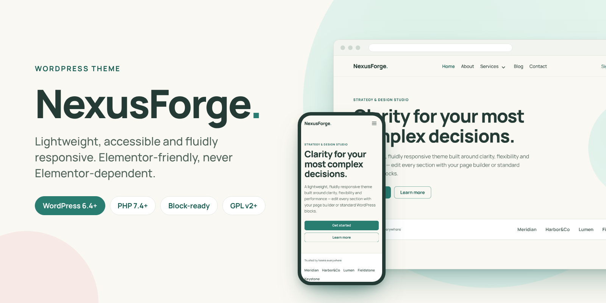
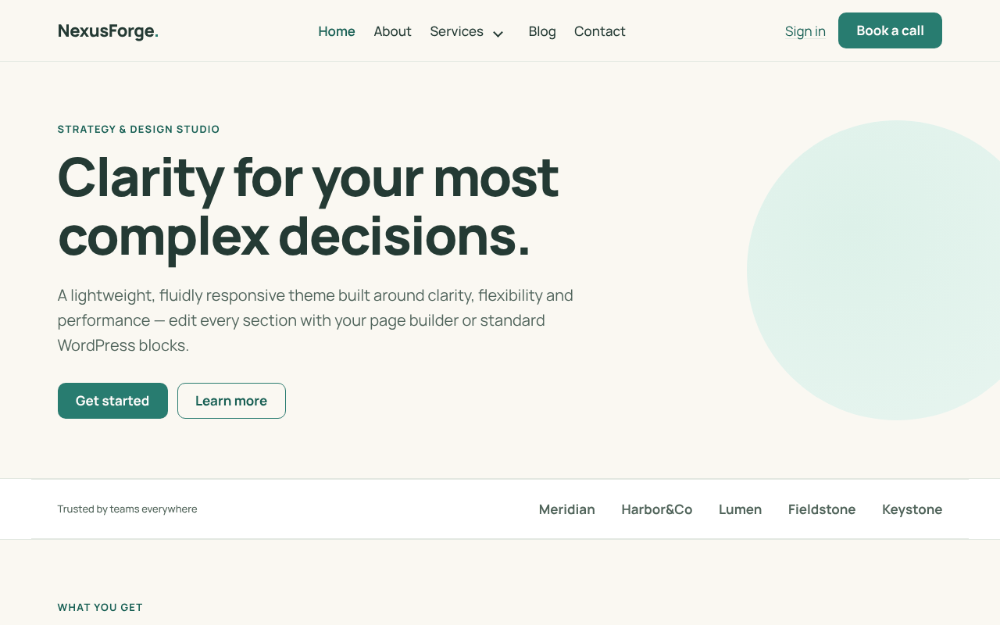
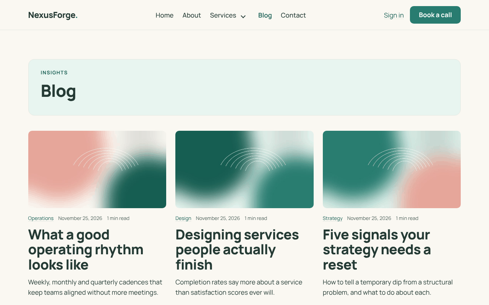
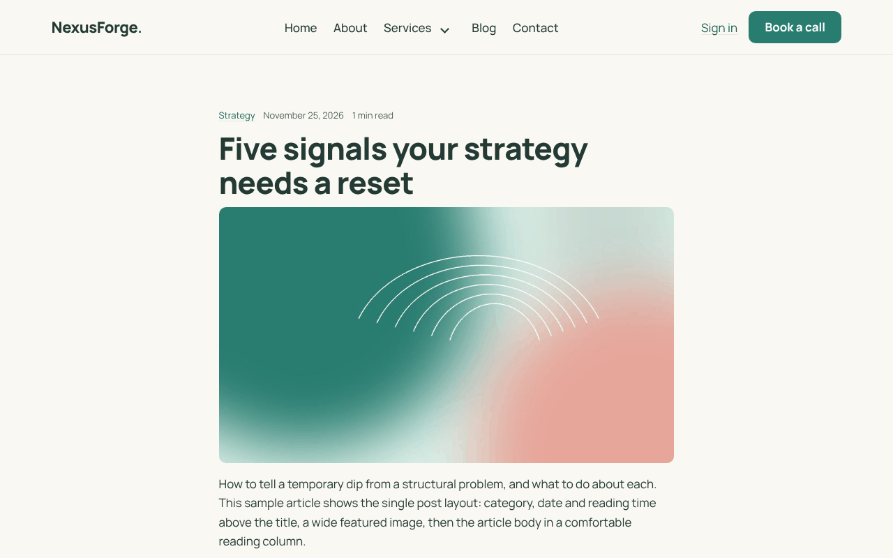
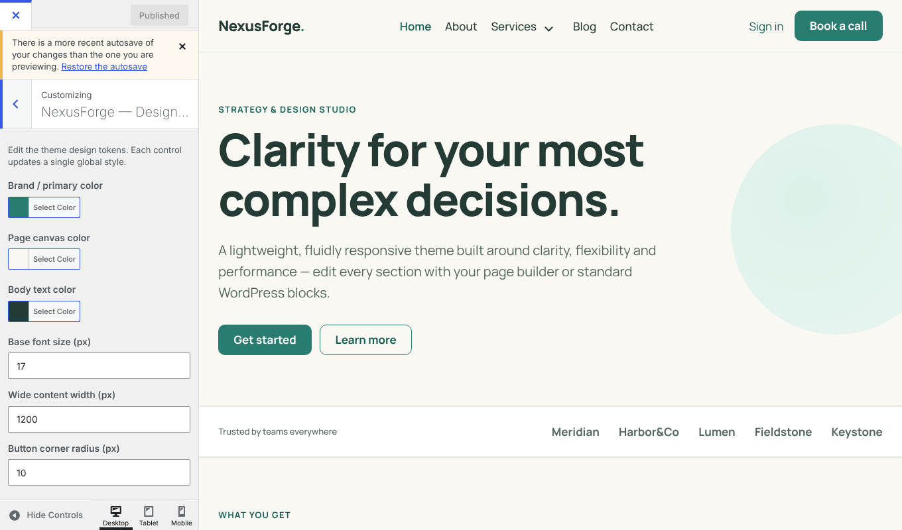
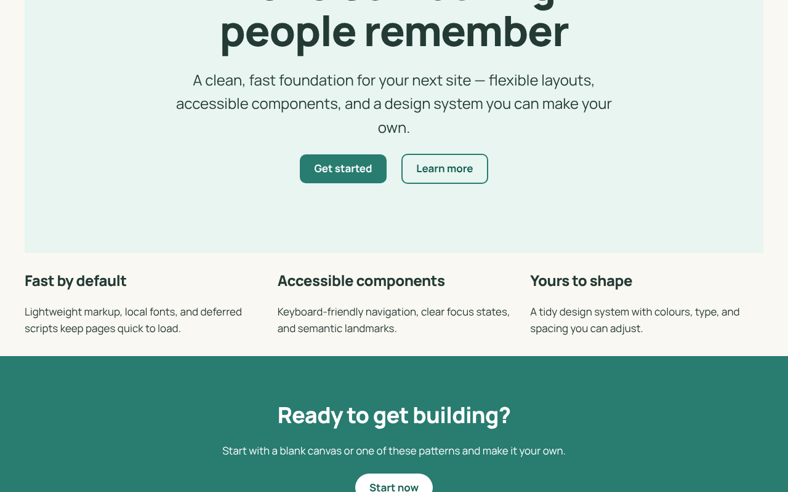
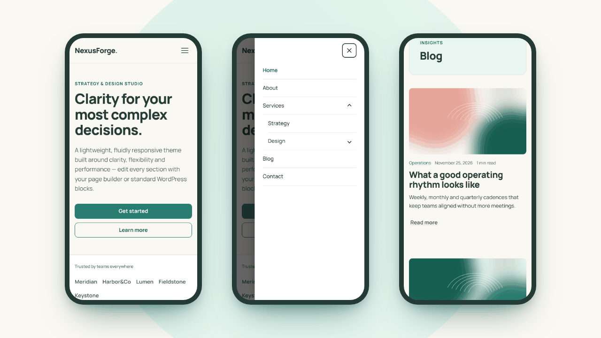

<p align="center">
  
</p>

<p align="center">
  <a href="https://github.com/Mostafijemon24/NexusForge-Theme/releases/latest"></a>
  
  
  
  <a href="LICENSE"></a>
  <a href="https://github.com/Mostafijemon24/NexusForge-Theme/releases"></a>
  <a href="https://github.com/Mostafijemon24/NexusForge-Theme/actions/workflows/release.yml"></a>
</p>

<p align="center">
  <a href="https://github.com/Mostafijemon24/NexusForge-Theme/releases/latest"><strong>Download</strong></a> ·
  <a href=".github/assets/NexusForge-Documentation.pdf"><strong>User guide (PDF)</strong></a> ·
  <a href="#installation"><strong>Installation</strong></a> ·
  <a href="readme.txt"><strong>Changelog</strong></a>
</p>

# NexusForge

NexusForge is a lightweight, fluidly responsive WordPress theme with a soft teal, mint and ivory identity. It is a hybrid classic theme: PHP templates for the page structure, `theme.json` for block editor settings, and a small set of CSS custom properties for colours, type and spacing.

It works on its own, with the block editor, and with Elementor. Elementor is supported but never required.

## Contents

- [Highlights](#highlights)
- [Screenshots](#screenshots)
- [Requirements](#requirements)
- [Installation](#installation)
- [Quick start](#quick-start)
- [Design System controls](#design-system-controls)
- [Block styles and patterns](#block-styles-and-patterns)
- [Accessibility](#accessibility)
- [Elementor](#elementor)
- [Documentation](#documentation)
- [Project structure](#project-structure)
- [Development and releases](#development-and-releases)
- [Testing](#testing)
- [Changelog](#changelog)
- [Licence and credits](#licence-and-credits)

## Highlights

| | |
|---|---|
| **Lightweight** | No CSS framework, no icon font, no jQuery. One small deferred script handles navigation. |
| **Fluid layout** | Type and spacing scale smoothly from small phones to ultrawide screens with `clamp()` and auto-fit grids. |
| **Six design controls** | Brand, canvas and text colours, base font size, content width and corner radius, all with live preview in the Customizer. |
| **Keyboard friendly** | Skip link, visible focus rings, dropdowns operable to three levels, and a focus-trapped mobile menu. |
| **Block ready** | Five block styles, three starter patterns, a theme palette and an editor canvas that matches the front end. |
| **Private by default** | The Manrope font is bundled with the theme. Nothing is loaded from other servers. |
| **Starter homepage** | A fresh install shows seven designed sections until you add your own homepage content. |
| **Translation ready** | Every string is translatable; a `.pot` template is included. |

## Screenshots

### Homepage

<p align="center">
  
</p>

### Blog and single post

| Blog grid | Single post |
|---|---|
|  |  |

### Customizer with live preview

<p align="center">
  
</p>

### A homepage built from the theme's patterns

<p align="center">
  
</p>

### Mobile

<p align="center">
  
</p>

## Requirements

| Item | Requirement | Notes |
|---|---|---|
| WordPress | 6.4 or newer | Tested up to 7.1. |
| PHP | 7.4 or newer | PHP 8.x is supported. |
| Plugins | None | Elementor (free) is optional. |
| Browsers | Current Chrome, Edge, Firefox and Safari | The mobile menu uses `inert` and `:focus-visible`. |

## Installation

1. Download `nexusforge-x.y.z.zip` from the [latest release](https://github.com/Mostafijemon24/NexusForge-Theme/releases/latest).
2. In WordPress go to **Appearance → Themes → Add Theme → Upload Theme**.
3. Choose the ZIP, click **Install Now**, then **Activate**.

> [!IMPORTANT]
> Use the `nexusforge-x.y.z.zip` file attached to a release. The automatic "Source code" archives and the green **Code → Download ZIP** button are not packaged for WordPress: they unpack into a folder with the wrong name and include repository-only files.

To install by FTP instead, unzip the release file and upload the `nexusforge` folder to `wp-content/themes/`.

## Quick start

A fresh install already looks complete, because the theme shows built-in starter sections on the homepage. These steps turn it into your site.

1. **Name and logo** — *Appearance → Customize → Site Identity*.
2. **Pages** — create at least *Home*, *About*, *Contact* and *Blog*. Give Contact the slug `contact` and About the slug `about`; the theme's built-in buttons link to those addresses.
3. **Homepage** — *Settings → Reading*: choose **A static page**, set *Home* as the homepage and *Blog* as the posts page.
4. **Menus** — *Appearance → Menus*: create a menu and tick **Primary Menu**. A second menu can go in **Footer Menu**.
5. **Colours** — *Appearance → Customize → NexusForge — Design System*.
6. **Footer** — *Appearance → Widgets*, **Footer** area.
7. **Homepage content** — edit *Home* with blocks, the theme's patterns or Elementor. As soon as the page has content it replaces the starter sections.

## Design System controls

Each control changes one global value and updates the preview instantly.

| Control | Default | Allowed values | CSS variable |
|---|---|---|---|
| Brand / primary color | `#287C70` | Any hex colour | `--nexusforge-color-brand` |
| Page canvas color | `#FAF8F2` | Any hex colour | `--nexusforge-color-canvas` |
| Body text color | `#243A34` | Any hex colour | `--nexusforge-color-text` |
| Base font size | 17 px | 14 – 22 px | `--nexusforge-fs-body` |
| Wide content width | 1200 px | 960 – 1440 px | `--nexusforge-wide` |
| Button corner radius | 10 px | 0 – 40 px | `--nexusforge-radius-md` |

Values are sanitized before they are saved and validated again when the stylesheet is generated: anything that is not a valid hex colour or an in-range number is ignored.

All other colours, sizes and spacing are CSS custom properties in [`assets/css/tokens.css`](assets/css/tokens.css) and can be overridden from a child theme or *Additional CSS*.

## Block styles and patterns

**Block styles**

| Block | Style | Effect |
|---|---|---|
| Button | Brand Outline | Transparent with a brand-colour border; fills on hover and focus. |
| Button | Pill | Fully rounded ends. |
| Group | Card | White panel with border, rounded corners and a soft shadow. |
| Image | Framed | Thin border and rounded corners. |
| Quote | Panel | Tinted call-out with a brand-colour rule. |

**Patterns** (block inserter → Patterns → NexusForge)

- Hero with call to action
- Three feature columns
- Call to action band

On the homepage, regular blocks sit in the 720 px reading column, **Wide** blocks use the wide container and **Full width** blocks run edge to edge.

## Accessibility

The theme targets WCAG 2.2 level AA. It makes no formal conformance claim; the colours and content you add matter too.

| Where | Key | Result |
|---|---|---|
| Anywhere | `Tab` / `Shift`+`Tab` | Move between links, buttons and fields, each with a visible 3 px focus ring. |
| Skip link | `Enter` | Jump to the main content. The link sits below the admin bar when you are logged in. |
| Menu item with sub-items | `Tab` onto it | Its dropdown opens. |
| Submenu button | `Enter` or `Space` | Open or close the dropdown. |
| Inside a dropdown | `Esc` | Close it and return focus to its button. |
| Mobile menu open | `Tab` / `Shift`+`Tab` | Cycle inside the menu only. |
| Mobile menu open | `Esc` | Close the menu and return focus to the menu button. |

Animations are switched off for visitors who ask their device to reduce motion.

## Elementor

| Elementor page layout | Theme header and footer | Use it for |
|---|---|---|
| Default | Shown | Regular pages. |
| Elementor Full Width | Shown | Edge-to-edge designs that keep the site navigation. |
| Elementor Canvas | Hidden | Landing pages with no theme chrome. |

The theme registers the standard Elementor Pro Theme Builder locations (header, footer, single, archive). That integration has not been tested on a licensed Pro installation.

## Documentation

A full illustrated user guide ships with the theme: 19 sections and 24 numbered screenshots covering installation, menus, the homepage, the Design System controls, the footer, block styles and patterns, Elementor, accessibility, translation, a developer reference and troubleshooting.

- **In the theme:** open `docs/index.html` in a browser. It works offline.
- **Online:** read the [PDF version](.github/assets/NexusForge-Documentation.pdf), also attached to every release.

## Project structure

```text
nexusforge/
├── style.css                  Theme header only
├── functions.php              Loads the modules in inc/
├── theme.json                 Editor palette, type, spacing, layout
├── header.php · footer.php    Site chrome
├── front-page.php · home.php · index.php · archive.php
├── single.php · page.php · search.php · 404.php
├── comments.php · searchform.php
├── inc/
│   ├── setup.php              Theme supports, menus, image sizes, widget area
│   ├── enqueue.php            Styles and scripts
│   ├── customizer.php         Design System settings and sanitisation
│   ├── customizer-css.php     Turns settings into validated CSS variables
│   ├── template-tags.php      Pluggable output helpers
│   ├── template-functions.php Body classes, menu fallback, helpers
│   ├── blocks.php             Block styles and patterns
│   ├── elementor.php          Loaded only when Elementor is active
│   └── class-nexusforge-walker-nav.php
├── template-parts/            header/, content/, front/
├── assets/                    css/, js/, fonts/
├── languages/nexusforge.pot
└── docs/                      Illustrated user guide
```

Repository-only files (`README.md`, `.github/`, `.gitattributes`, `.gitignore`) are left out of release ZIPs.

## Development and releases

The theme has no build step. Edit the files and reload.

To work on it locally, clone the repository into `wp-content/themes/` as `nexusforge`:

```bash
git clone https://github.com/Mostafijemon24/NexusForge-Theme.git nexusforge
```

To publish a release:

1. Update the version in `style.css`, `functions.php` (`NEXUSFORGE_VERSION`) and `readme.txt` (`Stable tag` and a changelog entry), then commit and push to `main`.
2. On GitHub open **Actions → Release → Run workflow**.

The [release workflow](.github/workflows/release.yml) reads the version from `style.css`, builds `nexusforge-<version>.zip` with `git archive`, creates the matching `v<version>` tag and publishes a release with the ZIP and the PDF guide attached. The release notes are taken from that version's entry in `readme.txt`. It stops if that version has already been released.

Pushing a `v<version>` tag by hand starts the same workflow.

To build the same ZIP by hand:

```bash
git archive --format=zip --prefix=nexusforge/ -o nexusforge.zip HEAD
```

## Testing

Version 1.0.4 was checked on local installs of WordPress 6.9 and 7.1 (PHP 8.3) with Chromium:

- Keyboard behaviour of the skip link, mobile menu, dropdowns and focus indicators, logged in and out, at four screen widths.
- Customizer sanitisation and generated CSS, including hostile values written straight to the database.
- axe-core scans of the main templates and the open-menu states, with no violations reported.
- WordPress Coding Standards security, escaping, i18n and prefix sniffs, and PHP 7.4+ compatibility, with nothing reported.

Not covered: Safari, Firefox, physical phones, screen readers, Elementor, and the WordPress.org Theme Check plugin.

## Changelog

See [`readme.txt`](readme.txt) for the full history. Highlights of 1.0.4:

- The mobile menu is a focus-trapped dialog with a Close button and a neutral overlay.
- The skip link no longer overlaps the WordPress admin bar.
- Visible focus indicators on every interactive element; dropdowns work by keyboard to three levels.
- Customizer values are validated again when the stylesheet is generated.
- Homepages built with blocks use the full width, and Wide alignment works on pages and posts.
- The block editor canvas uses the theme's font and colours.
- An illustrated user guide is included.

## Licence and credits

NexusForge is free software, released under the [GNU General Public License v2](LICENSE) or later.

| Resource | Licence |
|---|---|
| Manrope typeface, © 2019 The Manrope Project Authors | SIL Open Font License 1.1 (text in `assets/fonts/`) |
| Lucide-style inline SVG icons | ISC |

Copyright © 2026 NexusForge.
